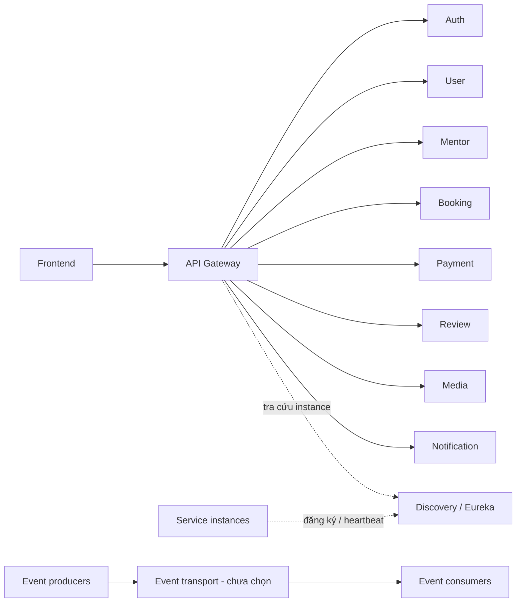

# Kiến trúc hệ thống và code

## Các quyết định nền

Monorepo, 8 ứng dụng nghiệp vụ và 2 ứng dụng platform; không core-service. Mỗi service build/deploy độc lập. Không dùng Git submodule để giả lập ranh giới; Git repo chung không đồng nghĩa dùng chung runtime hoặc database.



Đường nét đứt là registry/control plane, không phải đường vận chuyển business request. Gọi nội bộ dùng địa chỉ service tìm được và cơ chế cân bằng tải phù hợp, không bắt buộc đi vòng qua public Gateway. Gateway chỉ công khai route có chủ đích; không tự expose toàn bộ endpoint đăng ký trong Discovery.

## Layered Architecture theo tính năng

Ví dụ bên trong booking-service:

```text
com.mentormatching.booking
  booking/
    controller/
    service/
      command/
      query/
    repository/
    entity/
    dto/
      request/
      response/
      command/
      query/
    client/
    messaging/
  scheduling/
    controller/
    service/
    repository/
    entity/
    dto/
  config/
  security/
  exception/
```

Các thư mục chỉ tạo khi có nhu cầu. Không tạo interface/implementation cặp đôi cho mọi class một cách máy móc.

- Controller: HTTP binding, validation hình dạng request, chuyển principal và DTO.
- Command service: điều phối nghiệp vụ, phân quyền tài nguyên, state transition, transaction cục bộ.
- Query service: đọc/filter/page, trả DTO/projection; không âm thầm thay đổi trạng thái nghiệp vụ.
- Repository: truy vấn database của service; Spring Data JPA/SQL cho MySQL và PostgreSQL, Spring Data MongoDB cho MongoDB theo [chiến lược DBMS](database-strategy.md).
- Entity/document model: trạng thái và quy tắc cục bộ. JPA annotation cho SQL, Mongo mapping cho document được phép; không bắt buộc thêm một bản domain model framework-free.
- Client: tích hợp API liên service/provider, timeout và chuyển lỗi về lỗi có nghĩa.
- Messaging: publisher/consumer, envelope, outbox/inbox, mapping vào command/query service; không nhét toàn bộ nghiệp vụ vào listener.
- Config/security/exception: kỹ thuật chung trong phạm vi service.

Controller không gọi repository trực tiếp. Không trả JPA entity qua API. DTO/public contracts không chứa class của Hibernate, Stripe hay entity service khác.

## CQRS ban đầu

```text
Write: Controller/Consumer -> CommandService -> Repository -> Service DB
Read:  Controller         -> QueryService   -> Repository -> DTO/projection
```

Command/query dùng cùng database của service. Không mặc định event sourcing, read database riêng, framework CQRS hay broker chỉ vì tách hai loại service class. Event tích hợp phục vụ giao tiếp xuyên service là vấn đề khác với CQRS nội bộ.

`@Transactional` với transaction manager phù hợp chỉ bảo đảm thao tác database cục bộ. MongoDB multi-document transaction cần replica set và Mongo transaction manager/session; không dùng cấu hình JPA cho MongoDB. HTTP request hoặc publish broker không tự rollback cùng transaction. Tránh giữ DB lock khi gọi mạng kéo dài; xác định rõ bước lookup, local commit và outbox.

## Ranh giới phụ thuộc

- Không import entity, repository, command service từ service khác.
- API/event là contract versioned; consumer map sang DTO nội bộ của mình.
- Không tạo shared business model toàn hệ thống. Thư viện kỹ thuật chung chỉ thêm khi có nhu cầu thực tế và không buộc deploy đồng thời.
- DTO snapshot có thể trùng một số trường giữa service; đây là sự độc lập có chủ đích.
- Mỗi service có build file, cấu hình, migration và test riêng. Parent build nếu dùng chỉ quản lý build/version, không biến các service thành một artifact triển khai chung.

## Hạ tầng đã chọn và chưa chọn

Đã chọn hướng: Eureka Discovery và Spring Cloud Gateway. Hai skeleton Auth/User dùng Java 21, Boot 4.1.2 và Cloud 2025.1.4, xác minh theo Initializr và compatibility matrix; xem [service initialization](service-initialization.md).
Chưa chọn: broker, Config Server, Redis, tracing/metrics backend và orchestration production. Docker Compose là hướng môi trường local, chưa có file chạy.

Nguồn kỹ thuật: [Spring Cloud Netflix](https://spring.io/projects/spring-cloud-netflix/), [Spring Cloud Gateway](https://spring.io/projects/spring-cloud-gateway).
