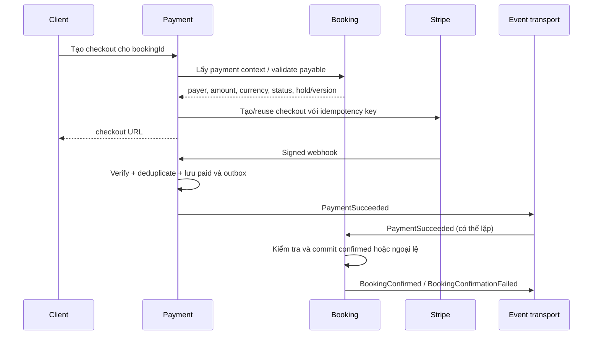

# Luồng nghiệp vụ và xử lý ngoại lệ

Tài liệu mô tả hành vi đích. State mới, event và API cần contract/test trước triển khai. Không suy ra mọi nhánh đã có trong monolith.

## 1. Đăng ký và hồ sơ người dùng

1. Client gửi đăng ký qua Gateway tới Auth.
2. Auth kiểm tra login identifier unique, hash password, tạo account/userId và ghi AccountRegistered vào outbox cùng local transaction.
3. User consume event, tạo hồ sơ tối thiểu theo userId; xử lý lại không tạo hồ sơ trùng.
4. Notification nhận yêu cầu thông báo phù hợp. Auth vẫn sở hữu token xác minh và quyết định xác minh thành công.
5. Client đăng nhập theo chính sách account/email verification đã chốt, lấy token và gọi User để hoàn thiện hồ sơ.

Nếu User/Notification tạm ngừng, account đã commit không bị rollback giả qua mạng; event được retry. GET profile phải trả trạng thái chưa sẵn sàng có mã lỗi rõ hoặc UI retry theo contract. Hỏng provision kéo dài cần cảnh báo và replay. Không truyền password/password hash/refresh token qua event chung.

## 2. Mentor onboarding

1. Người dùng có account và profile tạo hồ sơ Mentor.
2. Mentor chọn catalog subject-grade, đặt giá, thêm chuyên môn/thành tích và upload tài liệu qua Media.
3. Mentor kiểm tra media đã READY, đúng uploader/purpose, rồi lưu mediaId trong dữ liệu của mình.
4. Gửi hồ sơ duyệt; ADMIN/MANAGER được cấp quyền xem chứng chỉ và duyệt/từ chối.
5. Mentor sở hữu approval state, phát MentorApproved/MentorRejected. Auth cập nhật role theo chính sách đã chốt.
6. Mentor khai báo lịch tại Booking; Booking kiểm tra mentor hợp lệ và quyền sở hữu mentorId.

Quyền cập nhật hồ sơ, role MENTOR và điều kiện được nhận booking là ba khái niệm cần kiểm tra riêng.

## 3. Tìm mentor và xem lịch

Mentor phục vụ thông tin chuyên môn, catalog, location và projection tên/avatar/rating. Booking phục vụ lịch rảnh và lịch đã giữ/đặt. Review phục vụ danh sách đánh giá chi tiết. Projection được phép trễ; contract phải thể hiện version/updatedAt khi cần.
Lịch frontend chỉ có tính tham khảo. Lệnh tạo booking phải kiểm tra lại và đặt giữ chỗ atomically.

## 4. Tạo booking

1. Client gửi mentorId, mentorSubjectId, thời gian và hình thức học; studentUserId lấy từ principal.
2. Booking lấy snapshot User và Mentor qua API có timeout. Kiểm tra mentorSubjectId đúng mentor, mentor đủ điều kiện nhận học, duration/time hợp lệ.
3. Tính tiền từ giá authoritative; lưu amount và currency, không nhận tổng tiền frontend làm nguồn sự thật.
4. Trong transaction Booking, dùng chiến lược lock/constraint phù hợp để kiểm tra availability và xung đột, ghi booking/hold và outbox.
5. Trả booking PENDING và thông tin hết hạn nếu cơ chế hold đã được chốt.

Không chỉ dùng “SELECT không thấy trùng rồi INSERT”: hai request đồng thời có thể cùng thành công. Chọn chiến lược khóa theo mentor/ngày hoặc cơ chế tương đương, kiểm thử cạnh tranh thực tế. Cập nhật availability và booking phải phối hợp trên cùng quy tắc khóa.

Repo cũ có PENDING, CONFIRMED, COMPLETED, CANCELLED, REJECTED, NO_SHOW. Bản mới cần chốt thời hạn giữ chỗ và cách biểu diễn hết hạn (state EXPIRED hay lý do cancel) trước triển khai. PENDING có giữ lịch không, bao lâu, phải là quy tắc rõ ràng.

## 5. Thanh toán và xác nhận booking

- Payment xác minh payer từ principal và dữ liệu Booking. Lookup ban đầu không bảo đảm booking còn hợp lệ khi webhook đến.
- Webhook phải xác minh chữ ký trên raw payload; kiểm tra trạng thái thực sự đã thu tiền, amount/currency và correlation với payment nội bộ. Không coi mọi checkout completed là đã thu tiền cho mọi payment method.
- Ghi payment/outbox trong cùng transaction. ACK webhook sau khi lưu bền vững; consumer lỗi không làm mất sự kiện.
- Dùng provider event ID để deduplicate webhook; dùng idempotency key khi tạo checkout và hoàn tiền. Timeout tạo checkout cần tra/reuse thay vì tạo giao dịch mới mù quáng.
- Booking xử lý event trong transaction, kiểm tra paymentId/bookingId/payer/amount/currency và trạng thái/hold; không xác nhận lịch đã nhường cho booking khác.
- Event lặp không xác nhận hai lần. Race giữa hết hạn/từ chối và thanh toán phải dùng atomic state transition.
- Nếu booking không thể xác nhận, Payment vẫn là đã thu tiền. Ghi ngoại lệ và tiến hành hoàn tiền/đối soát theo policy; không đổi thành FAILED để che mất giao dịch.
- Client có thể thấy payment PAID nhưng booking còn PENDING trong lúc event đang xử lý; UI hiển thị đang xác nhận, không yêu cầu thanh toán lại.

## 6. Từ chối, hủy và hoàn thành

Repo cũ cho mentor từ chối PENDING, hoàn thành CONFIRMED sau giờ kết thúc, quản trị force-cancel với điều kiện trạng thái. Giữ các invariant này làm cơ sở đánh giá, không mở rộng quyền vô điều kiện.
Booking là owner chuyển trạng thái. Hủy booking đã trả tiền có thể khởi tạo workflow refund tại Payment; chính sách cutoff, phí, người phê duyệt và refund một phần còn mở.
Chỉ Payment cập nhật refund state sau xác nhận provider. Retry/refund reconciliation phải phát hiện timeout sau khi provider đã thực hiện.

## 7. Review

1. Review lấy review-eligibility context từ Booking (ban đầu dùng API đồng bộ).
2. Xác minh booking COMPLETED, studentUserId khớp caller, mentorId lấy từ booking.
3. Tạo review với uniqueness theo booking; constraint cục bộ chặn request cạnh tranh.
4. Cập nhật rating aggregate và outbox cùng transaction; phát MentorRatingUpdated.
5. Mentor cập nhật rating projection theo version, bỏ qua event cũ.

Nếu Booking không phản hồi, trả lỗi retryable, không bỏ qua eligibility. Repo cũ cho tác giả sửa trong 30 ngày và có quyền xóa cho tác giả/admin-manager; xác nhận giữ chính sách này trước triển khai. Xóa/ẩn/sửa đều phải làm mới aggregate. Moderation policy mới chưa chốt.

## 8. Media

1. Client xin upload intent tại Media; server xác định access type từ purpose.
2. Media ghi PENDING và trả thông tin ký để upload trực tiếp Cloudinary (hướng provider ban đầu).
3. Client upload rồi confirm. Media xác minh owner, object key và bằng chứng provider đáng tin cậy; không chỉ tin URL/size client gửi.
4. Media chuyển READY; thao tác retry an toàn.
5. Client gọi User/Mentor/Review để gắn mediaId. Service đó kiểm tra quyền resource và điều kiện asset.

VERIFICATION là private; avatar/thành tích theo chính sách public. Không công khai URL cố định cho tài liệu private. Service nghiệp vụ xác thực quyền rồi yêu cầu Media tạo quyền truy cập ngắn hạn.
Cleanup file PENDING quá hạn và file không còn dùng cần cơ chế usage/lease chống race attach–delete. Chưa triển khai xóa tự động khi chưa chốt contract.

## 9. Notification và báo cáo

Notification consume các sự kiện đã commit, deduplicate theo event + recipient + channel. Việc gửi email thất bại không rollback booking/payment. Ghi retry, trạng thái delivery và lỗi cuối; read/unread thuộc Notification.
Dashboard lấy aggregate theo service; không join DB xuyên service. Cách compose endpoint/read model và độ trễ số liệu sẽ quyết định riêng trước khi chuyển module stats.
